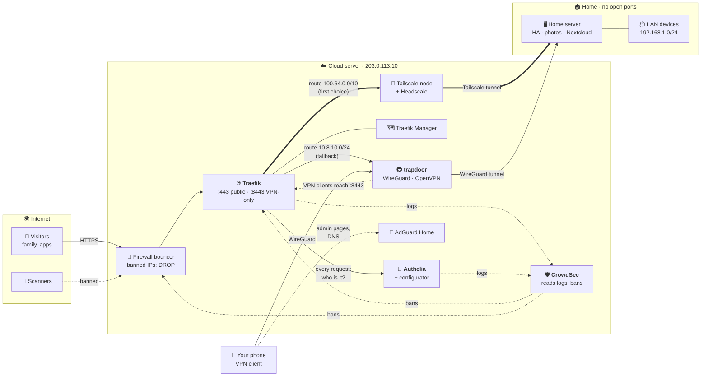

<h1 align="center">🚪 Homelab Gateway Stack</h1>

<p align="center">
  <b>Your home services on the internet, without opening a single port at home.</b><br>
  One small cloud server in front. Login with 2FA, automatic bans, VPN tunnels home, and a backup tunnel when the first one drops.
</p>

<p align="center">
  <a href="#-the-problem">The problem</a> ·
  <a href="#-what-you-get">What you get</a> ·
  <a href="#-the-parts">The parts</a> ·
  <a href="#-how-it-fits-together">How it fits</a> ·
  <a href="#-getting-started">Get started</a> ·
  <a href="#-things-worth-knowing-before-you-start">Before you start</a>
</p>

---

## 🤔 The problem

You run Home Assistant, a photo library, Nextcloud, maybe Plex, on a machine at home. You
want to reach them from anywhere, and share some of them with family.

The usual answers all hurt somewhere:

- **Open ports on the home router.** Your home address is now on every scanner's list, each
  app has to defend itself, and with CGNAT or a changing IP it does not work at all.
- **A VPN app on every phone.** Safe, but your partner will not open a VPN to turn on the
  lights, and nothing works from a browser on someone else's computer.
- **A hosted tunnel service.** Easy, but your traffic and your logins go through someone
  else's servers, and the free tier has limits that you find the day you need it.

What is missing is a **front door you own**: one cheap server with a public address that
checks who is knocking, bans who should not, and carries the allowed requests home through
an encrypted tunnel that **your home opens from the inside**.

That is what this is.

## ✨ What you get

|  | |
| :-- | :-- |
| 🏠 **No open ports at home** | Your home machine dials out to the cloud server. The router stays closed, and CGNAT or a changing IP does not matter. |
| 🔐 **One login, with 2FA, for everything** | Authelia puts a single sign-on page with a one-time code in front of every app, including apps with no login of their own. |
| 🛡️ **Scanners banned automatically** | CrowdSec watches the logs and blocks addresses that probe or brute-force, for every site at once, and pulls in a community blocklist. |
| 🔁 **Two tunnels, automatic failover** | Each service is reached over Tailscale first and WireGuard (or the other way round). If one tunnel goes down, Traefik switches by itself and switches back. |
| 📱 **A VPN for your own devices** | The same server is your VPN: WireGuard, AmneziaWG or OpenVPN, with a web UI for clients, QR codes, traffic and access rules. |
| 🖱️ **Managed in a browser** | Routes in Traefik Manager, login rules and users in the Authelia configurator, VPN clients in trapdoor. No YAML editing for day-to-day changes. |
| 🙈 **Admin pages invisible from the internet** | The admin UIs only answer over the VPN. From the internet they do not exist. |
| 💸 **Cheap and yours** | A 2 GB cloud VM runs all of it. Open source end to end; your traffic and logins never pass through a third party. |

## 🧩 The parts

Each piece is its own project. Start with the first two and add the others when you need them.

### 🌐 Front door: [Traefik](https://traefik.io/traefik/)

**What it is:** the reverse proxy that answers on ports 80 and 443, gets the Let's Encrypt
certificates, and decides where each request goes.

**Why you want it:** it is the one place every request passes, so it is where the login
check, the bans and the routing to your tunnels live. Routes are plain files it reloads by
itself, and each home service can list two tunnel addresses with a health check, so Traefik
always uses one that works.

### 🔐 Login and 2FA: [Authelia](https://www.authelia.com/) + [authelia-webui](https://github.com/shuricksumy/authelia-webui)

**What it is:** Authelia is the login portal (password plus one-time code, passkeys, OIDC
for apps that support it). The **Authelia configurator** from authelia-webui is a web UI for
the parts that change often: access rules, users, OIDC clients.

**Why you want it:** every app gets the same strong login without touching the app. Rules
say who may open what, from where: "family may open the photos", "only me, only over the VPN,
with 2FA, may open the admin pages". The configurator checks each change with Authelia
itself, keeps a history, and rolls back by itself if Authelia does not come back healthy.

<table>
  <tr>
    <td width="50%"><br><sub><b>Access rules</b> in the Authelia configurator: reorder, switch off, test a URL.</sub></td>
    <td width="50%"><br><sub><b>Safe apply:</b> validated, committed, restarted, health-checked, rolled back on failure.</sub></td>
  </tr>
</table>

### 🗺️ Routes in a browser: [Traefik Manager](https://github.com/chr0nzz/traefik-manager)

**What it is:** a web UI for Traefik's route files: routers, services, middlewares, and a map
of how they connect.

**Why you want it:** adding a service becomes a form instead of a YAML edit, with a backup
before every change. It runs without the Docker socket and only on the VPN, as set up in
[authelia-webui's guide](https://github.com/shuricksumy/authelia-webui/blob/main/docs/traefik-manager.md).

### 🛡️ Automatic bans: [CrowdSec](https://www.crowdsec.net/)

**What it is:** reads Traefik's and Authelia's logs, recognises attacks (scanners, brute
force, known CVE probes), and bans the address. A plugin in Traefik enforces the ban on every
site; an optional firewall bouncer drops the address on every port.

**Why you want it:** a public server is scanned within minutes of going online. CrowdSec
turns that noise into bans without you reading a single log, and its community blocklist
stops thousands of known attackers before they try anything. If CrowdSec stops, your sites
stay up (it fails open).

### 🚇 Tunnels and your VPN: [trapdoor](https://github.com/shuricksumy/trapdoor)

**What it is:** a web UI for your own WireGuard, AmneziaWG and OpenVPN servers: clients, QR
codes, live sessions, traffic history, access rules, start/stop scripts.

**Why you want it:** it serves two jobs here. Your **home machine** is a WireGuard client of
it, so Traefik reaches your home services through that tunnel. And your **phones and
laptops** are clients too, which is how you reach the admin pages that the internet cannot see.
AmneziaWG gets through networks that block plain VPNs.

<table>
  <tr>
    <td width="50%"><br><sub><b>trapdoor overview:</b> who is connected, today's traffic, what needs attention.</sub></td>
    <td width="50%"><br><sub><b>Clients:</b> one per device; the home server is just another client, with its LAN behind it.</sub></td>
  </tr>
</table>

### 🔁 The second tunnel: [Headscale](https://headscale.net/) + [Headplane](https://github.com/tale/headplane) + [Tailscale](https://tailscale.com/)

**What it is:** Headscale is a self-hosted control server for Tailscale clients; Headplane
is its web UI. A Tailscale node on the cloud server joins the same network as your home machine.

**Why you want it:** a second, independent path home. Tailscale finds a way through almost
any network on its own. Traefik uses it first and falls back to WireGuard (or the other way
round), so a broken tunnel is a non-event instead of an outage.

### 🕸️ Optional third path: [ZeroTier](https://www.zerotier.com/) with [ZTNET](https://ztnet.network/)

**What it is:** your own ZeroTier network controller with a web UI.

**Why you want it:** for devices that already speak ZeroTier, or a third route to a second
site. Same idea as Tailscale: a member on the cloud server, a route through it.

### 🧭 DNS for VPN clients: [AdGuard Home](https://adguard.com/adguard-home/overview.html)

**What it is:** a DNS server with ad blocking and local rewrites.

**Why you want it:** VPN clients ask it for names, so `vpn.example.com` and the other admin
hosts resolve to the internal address only VPN clients can reach (split DNS). Ads and
trackers are blocked on every connected phone as a bonus.

### 🏁 One start page: [foyer](https://github.com/shuricksumy/foyer)

**What it is:** a config-driven start page: a sidebar of your services that open in a pane
next to it.

**Why you want it:** one bookmark for everything, with the admin UIs (trapdoor, the
configurator, Traefik Manager) shown inside it. They allow being framed only by this page.

## 🔗 How it fits together



**A request from the internet** (`https://home.example.com`):

1. The firewall bouncer and CrowdSec let it through (the address is not banned).
2. Traefik asks Authelia: is this visitor signed in, and allowed here? If not, they get the
   login page with a one-time code.
3. Traefik sends the request to the home server's **Tailscale** address. If that tunnel's
   health check fails, it uses the **WireGuard** address instead.
4. The answer comes back the same way. The home router never accepted a connection.

**An admin page** (`https://vpn.example.com:8443`, trapdoor's UI) works only from a VPN
client: AdGuard resolves the name to Traefik's internal address, which only VPN clients can
reach, and Authelia also checks that the request comes from the VPN range. From the internet
the name does not resolve and the port is closed.

The full picture with every network and address: **[docs/architecture.md](docs/architecture.md)**.

## 🚀 Getting started

**You need:** a cloud VM with a public IPv4 address (2 GB RAM is enough; 1 GB works without
ZeroTier), a domain whose DNS you control, Docker with the Compose plugin, and a Linux
machine at home that can run Docker or WireGuard.

Pick your starting point:

| I want to… | Start with |
| :-- | :-- |
| understand the design before deploying anything | [docs/architecture.md](docs/architecture.md) |
| deploy the whole stack, step by step, with a check after each step | [docs/deploy.md](docs/deploy.md) |
| reach my home services through a tunnel, with failover | [docs/tunnels.md](docs/tunnels.md) |
| know what is public, what is VPN-only, and why | [docs/security.md](docs/security.md) |
| keep it running: updates, backups, when something breaks | [docs/operations.md](docs/operations.md) |
| go deep on Authelia, Traefik Manager or CrowdSec | [authelia-webui docs](https://github.com/shuricksumy/authelia-webui/tree/main/docs) |
| go deep on the VPN servers | [trapdoor's guide](https://github.com/shuricksumy/trapdoor/blob/main/docs/guide.md) |

**Working compose files** for every part, layered so you can start small and add parts one
at a time, are in **[`examples/`](examples/)**:

```bash
git clone https://github.com/shuricksumy/homelab-gateway-stack
cd homelab-gateway-stack/examples
cp .env.example .env          # your domain, addresses and secrets
# then follow docs/deploy.md, phase by phase
```

## 💡 Things worth knowing before you start

- **Traffic into a tunnel needs NAT on the tunnel's end.** Traefik's requests come from the
  Docker network (`172.30.0.x`), and your home machine has no route back there. Masquerade
  them into the tunnel (one line in trapdoor's start script, [docs/tunnels.md](docs/tunnels.md#nat-into-the-tunnel))
  or the requests arrive and the answers vanish. The symptom: everything times out, although
  the tunnel is up.
- **Pin the addresses on the proxy network.** Traefik's routes point at the tunnel containers
  by IP. If one of them is recreated without its fixed address, the routes point at nothing.
  Keep every fixed address in the `.env` of the compose project that uses it.
- **Tell your apps who the proxy is.** Home Assistant and many others answer
  **400 Bad Request** when `X-Forwarded-For` comes from an address they do not trust. Trust
  the tunnel ranges the requests arrive from (`10.8.10.0/24`, `100.64.0.0/10`), not the world.
- **Admin pages: VPN-only, then Authelia, then their own login.** Three locks, each
  independent. A mistake in one route does not expose anything.
- **Some apps cannot sit behind a login page.** Mobile apps (Home Assistant, Nextcloud, Plex)
  talk to their API directly. Give those hosts a `bypass` or a narrower rule in Authelia and
  let CrowdSec and the app's own login protect them.
- **Static Traefik config is read at start only.** Entry points, plugins and the access log
  need `docker compose up -d --force-recreate traefik`; routes in `traefik/dynamic/` reload
  by themselves.
- **Small VM, careful with memory.** Everything here fits in 2 GB. Watch out for log files
  without rotation and image caches: prune them on a schedule
  ([docs/operations.md](docs/operations.md)).

---

<p align="center"><sub>MIT, like everything it links to · built because opening ports at home was never the answer</sub></p>
