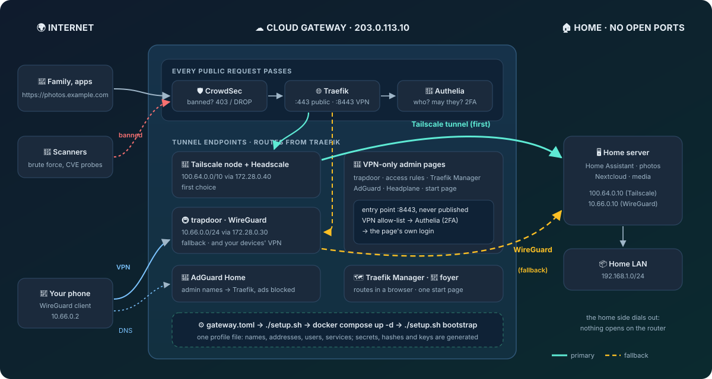
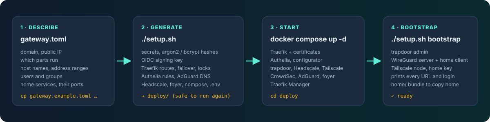
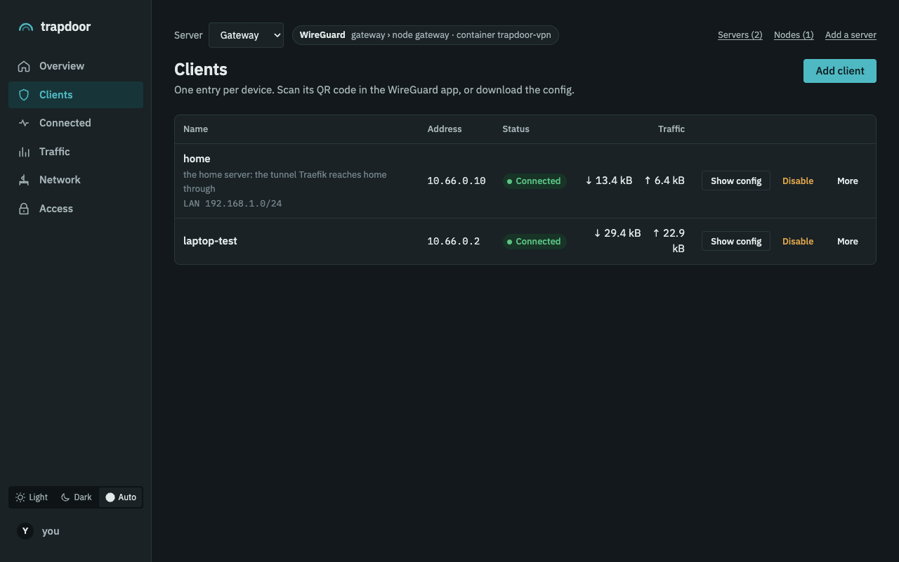
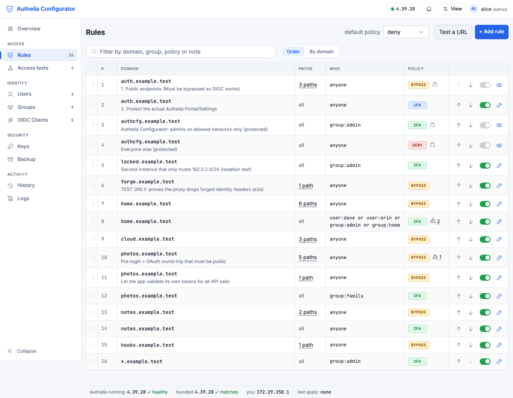
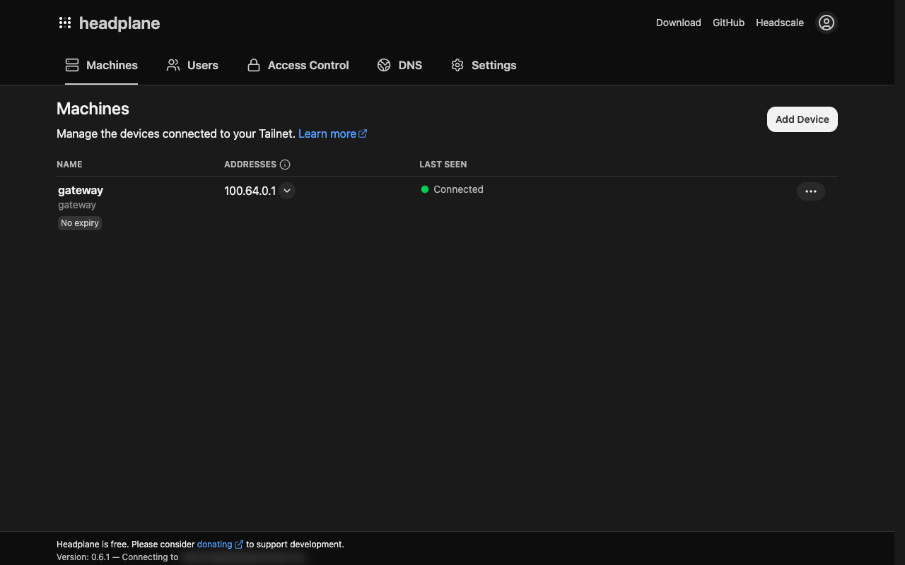
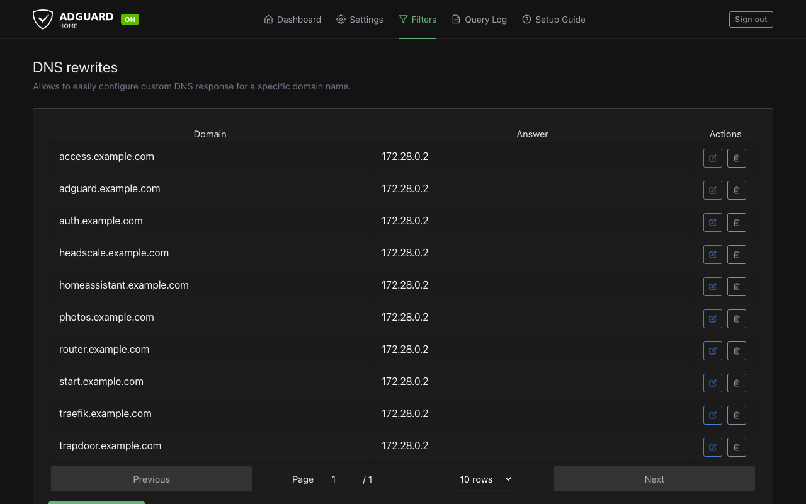
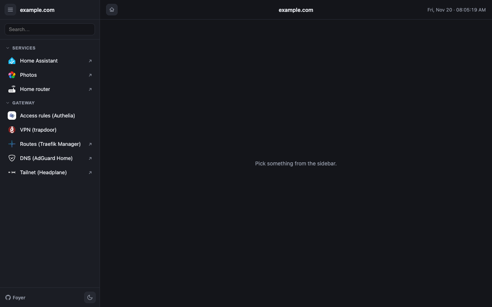
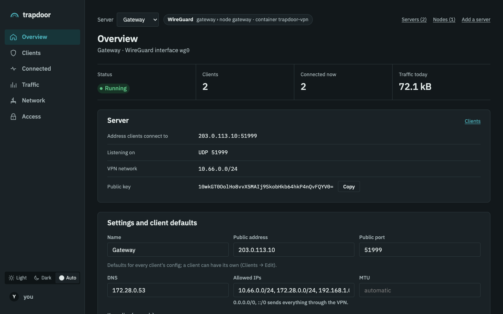

<h1 align="center">🚪 Homelab Gateway Stack</h1>

<p align="center">
  <b>Your home services on the internet, without opening a single port at home.</b><br>
  One small cloud server in front: login with 2FA, automatic bans, a VPN for your devices,<br>
  and two tunnels home that take over from each other. Described in one file, set up by one script.
</p>

<p align="center">
  <a href="#-what-you-get">What you get</a> ·
  <a href="#-how-it-fits-together">How it fits</a> ·
  <a href="#-quick-start">Quick start</a> ·
  <a href="#-what-it-looks-like">Screenshots</a> ·
  <a href="#-the-projects-behind-it">The projects</a> ·
  <a href="docs/guide.md"><b>The guide</b></a>
</p>

<p align="center">
  
</p>

---

## 🤔 The problem

You run Home Assistant, photos, Nextcloud, maybe Plex at home, and want them from anywhere,
shared with family. Opening ports puts your home address on every scanner's list (and does not
work at all behind CGNAT). A VPN app on every phone is safe but nobody in the family uses it.
A hosted tunnel sends your traffic and your logins through someone else's servers.

What is missing is a **front door you own**: a cheap server with a public address that checks
who is knocking, bans who should not, and carries the rest home through tunnels that **your home
opens from the inside**.

## ✨ What you get

|  | |
| :-- | :-- |
| 🏠 **No open ports at home** | The home server dials out. CGNAT or a changing home IP does not matter. |
| 🔐 **One login with 2FA for everything** | Authelia in front of every app, also the ones without a login of their own. Rules per group: family sees the photos, only admins see the admin pages. |
| 🛡️ **Scanners banned automatically** | CrowdSec reads the logs and blocks probing and brute force on every site at once, plus a community blocklist. |
| 🔁 **Two tunnels, automatic failover** | Each service over Tailscale first, WireGuard when Tailscale is down, and back. No outage when a tunnel drops. |
| 📱 **A VPN for your devices** | WireGuard / AmneziaWG / OpenVPN with a web UI: clients, QR codes, traffic, access rules. |
| 🙈 **Admin pages invisible from the internet** | They answer only to VPN clients, behind three locks (network, Authelia, their own login). From the internet they do not exist. |
| ⚙️ **One profile, one script** | Names, addresses, users and services in `gateway.toml`; `setup.sh` generates every config, secret, hash and key. |
| 💸 **Cheap and yours** | A 2 GB cloud VM runs all of it. Open source end to end. |

## 🔗 How it fits together

Three ideas carry the whole design ([the guide](docs/guide.md#2-how-it-works) has the details):

1. **One Docker network, fixed addresses.** Traefik and every tunnel endpoint (trapdoor's VPN
   container, the Tailscale node, ZeroTier) sit on one network, each at a fixed address.
2. **Routes inside Traefik.** Traefik's container runs a small script that routes each tunnel's
   range to the container that owns the tunnel. A request for `100.64.0.10` leaves through the
   Tailscale node, one for `10.66.0.10` through trapdoor.
3. **NAT on the tunnel's end.** The tunnel container gives Traefik's requests its own tunnel
   address, so the home server can answer them. VPN clients, the other way round, reach Traefik
   **without** NAT, so every lock sees their real VPN address.

## 🚀 Quick start

<p align="center">
  
</p>

**You need:** a cloud VM with a public IPv4 address (2 GB RAM), Docker with Compose 2.33+, a
domain whose DNS you control, and a machine at home that runs Docker or WireGuard.

```bash
git clone https://github.com/shuricksumy/homelab-gateway-stack && cd homelab-gateway-stack/stack
cp gateway.example.toml gateway.toml     # your domain, IP, users, home services
sudo ./setup.sh                          # → ../deploy: every config, secret, hash and key
cd ../deploy && docker compose up -d
sudo ../stack/setup.sh bootstrap         # first logins, the VPN server, the tunnel keys
```

`bootstrap` ends with every address and login, and a `home/` folder with the WireGuard config and
a Tailscale key for your home server. Change the profile and run `setup.sh` again at any time:
secrets are kept, and the files the web UIs edit (rules, users, your own routes) are left alone.

The full walkthrough, every profile option, and what to check after each step:
**[docs/guide.md](docs/guide.md)**.

## 📸 What it looks like

<table>
  <tr>
    <td width="50%"><br><sub><b>trapdoor:</b> the home server (with its LAN behind it) and a laptop, both connected. Created by <code>setup.sh bootstrap</code>.</sub></td>
    <td width="50%"><br><sub><b>Authelia configurator:</b> who may open what, from where, with 2FA. Every change validated and rolled back on failure.</sub></td>
  </tr>
  <tr>
    <td width="50%"><br><sub><b>Headplane:</b> your own tailnet; the gateway's node is the second tunnel's endpoint.</sub></td>
    <td width="50%"><br><sub><b>AdGuard Home:</b> for VPN clients every gateway name points at Traefik's internal address. Generated from the profile.</sub></td>
  </tr>
  <tr>
    <td width="50%"><br><sub><b>foyer:</b> one start page for the services and every admin page, generated from the profile.</sub></td>
    <td width="50%"><br><sub><b>trapdoor:</b> the WireGuard server with the AdGuard DNS and the split tunnel (VPN, gateway, home LAN) for every client.</sub></td>
  </tr>
</table>

<sub>All screenshots are from a test run of this repository's own `setup.sh` with the example
profile: placeholder names and addresses only.</sub>

## 🧩 The projects behind it

**Built for this stack** (same author, each usable on its own):

| | |
| :-- | :-- |
| 🚇 **[trapdoor](https://github.com/shuricksumy/trapdoor)** | Web UI for your own OpenVPN, WireGuard and AmneziaWG servers: the VPN and the WireGuard tunnel home. Successor to [openvpn-ui](https://github.com/shuricksumy/openvpn-ui). |
| 🔐 **[authelia-webui](https://github.com/shuricksumy/authelia-webui)** | The Authelia configurator: access rules, users and OIDC clients in a browser, with safe apply. Its docs cover Traefik Manager, CrowdSec, blocklists and hardening in depth. |
| 🏁 **[foyer](https://github.com/shuricksumy/foyer)** | The start page: a sidebar of your services, opening in a pane next to it. |
| 🏡 **[home-assistant-apps](https://github.com/shuricksumy/home-assistant-apps)** | Puts services that run on other machines back into the Home Assistant sidebar. |
| 🎶 **[home-audio-stack](https://github.com/shuricksumy/home-audio-stack)** | An example of what lives behind the gateway: multiroom Hi-Fi with Music Assistant. |
| 🔄 **[renovate-config](https://github.com/shuricksumy/renovate-config)** | Shared Renovate presets: keeps pinned image versions like the ones here up to date. |

**Open-source projects it is made of:** [Traefik](https://traefik.io/traefik/),
[Authelia](https://www.authelia.com/), [CrowdSec](https://www.crowdsec.net/),
[Traefik Manager](https://github.com/chr0nzz/traefik-manager), [Headscale](https://headscale.net/),
[Headplane](https://github.com/tale/headplane), [Tailscale](https://tailscale.com/),
[AdGuard Home](https://adguard.com/adguard-home/overview.html), [ZeroTier](https://www.zerotier.com/)
with [ZTNET](https://ztnet.network/).

## 💡 Worth knowing before you start

- **Admin pages need the VPN first.** `bootstrap` makes a WireGuard client for your first device
  (`deploy/clients/<you>-device.conf`): import it in the WireGuard app, and every admin page
  opens by name.
- **Apps behind a proxy want to know it.** Home Assistant and Nextcloud answer *400 Bad Request*
  until they trust the tunnel ranges. `deploy/home/README.md` has the lines.
- **Mobile apps cannot pass a login page.** Services like Home Assistant get `login = false` in the
  profile and rely on their own login, 2FA and CrowdSec.

---

<p align="center"><sub>MIT, like everything it links to · built because opening ports at home was never the answer</sub></p>
