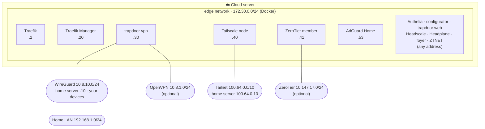
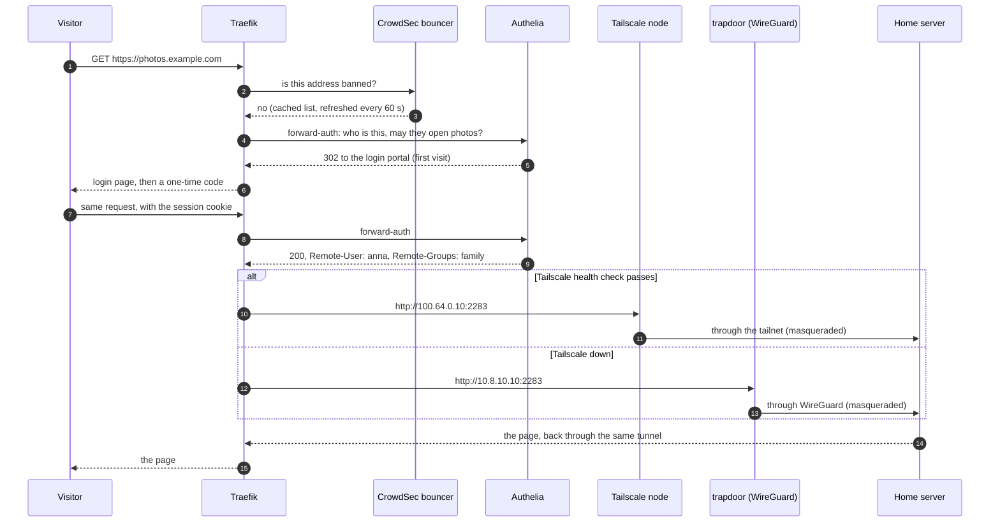

# Architecture

How the parts connect: the networks, the addresses, and the path of a request. All
addresses are the placeholders of [`examples/.env.example`](../examples/.env.example); keep
the shape and use your own values.

## The machines

| Machine | Role | Opens ports? |
| :-- | :-- | :-- |
| **Cloud server** (`203.0.113.10`) | the front door: Traefik, Authelia, CrowdSec, the VPN servers, the tunnel endpoints | yes: 80, 443 (TCP); 51820 (UDP, WireGuard); optionally 1194 (UDP, OpenVPN), 9993 (UDP, ZeroTier) |
| **Home server** | your apps; dials out to the cloud server through one or more tunnels | **none** |
| **Your devices** | VPN clients of the cloud server; reach the admin pages through it | none |

## The networks



**One Docker network, `edge`, holds everything Traefik talks to.** The containers that a route,
an allow-list or a trusted-proxy setting points at get a **fixed address**:

| Address | Container | Who relies on the address |
| :-- | :-- | :-- |
| `172.30.0.2` | Traefik | the configurator, trapdoor and Traefik Manager trust `X-Forwarded-For` only from it |
| `172.30.0.20` | Traefik Manager | the allow-list of Traefik's API |
| `172.30.0.30` | trapdoor's vpn container | Traefik's routes to `10.8.10.0/24`, `10.8.1.0/24`, `192.168.1.0/24` |
| `172.30.0.40` | Tailscale node | Traefik's route to `100.64.0.0/10` |
| `172.30.0.41` | ZeroTier member | Traefik's route to `10.147.17.0/24` |
| `172.30.0.53` | AdGuard Home | the DNS server VPN clients get |

The others are reached by name (`authelia`, `trapdoor-web`, `headscale`, ...) and can take any
address.

## Routes into the tunnels

Traefik's own container gets one route per tunnel range, via the container that owns the tunnel.
The `traefik-routes` helper adds them ([`examples/traefik/routes.sh`](../examples/traefik/routes.sh)):

```
10.8.10.0/24    via 172.30.0.30   trapdoor WireGuard  (home server, your devices)
10.8.1.0/24     via 172.30.0.30   trapdoor OpenVPN
192.168.1.0/24  via 172.30.0.30   the home LAN, behind the home server's WireGuard client
100.64.0.0/10   via 172.30.0.40   the tailnet
10.147.17.0/24  via 172.30.0.41   ZeroTier
```

This one table does two jobs:

- **Traefik → home.** A route to `http://100.64.0.10:8123` leaves Traefik towards the Tailscale
  node, which forwards it into the tailnet. On the way in, the tunnel container masquerades it,
  so the home server sees the tunnel's address and answers through the tunnel
  ([tunnels.md](tunnels.md#nat-into-the-tunnel)).
- **Your devices → admin pages.** A phone on WireGuard (`10.8.10.5`) opens
  `https://vpn.example.com:8443`. AdGuard resolves the name to `172.30.0.2`. The packet goes
  through the vpn container straight onto the edge network, **without NAT**, and Traefik's answer
  goes back to `10.8.10.5` through the same route. So Traefik, Authelia and the configurator see
  the phone's real VPN address, which is what the `vpn` network in the Authelia rules and the
  `vpn-only` allow-list check.

## Entry points

| Entry point | Port | Reachable from | Serves |
| :-- | :-- | :-- | :-- |
| `web` | 80 (published) | the internet | redirect to HTTPS only |
| `websecure` | 443 (published) | the internet | the login portal, Headscale, your public services |
| `internal` | 8443 (**not published**) | the edge network, so VPN clients only | every admin page |
| `tmapi` | 8081 (not published) | Traefik Manager's address only | Traefik's API |

The internal entry point is not a port on the server's public address. From the internet it
does not exist, whatever the routes say.

## A request, step by step



## What lives where

```
examples/
  compose.yml                   Traefik + routes helper, Authelia, Redis, configurator,
                                socket proxy, AdGuard Home, foyer
  compose.trapdoor.yml          trapdoor: vpn container, agent, web UI
  compose.headscale.yml         Headscale, Headplane, Tailscale node + NAT helper
  compose.crowdsec.yml          CrowdSec (+ Traefik joins its network)
  compose.traefik-manager.yml   Traefik Manager
  compose.zerotier.yml          ZTNET, PostgreSQL, ZeroTier controller/member + NAT helper
  traefik/traefik.yml           static config: entry points, certificates, plugins
  traefik/dynamic/              routes, reloaded on change
    core.yml                      portal, configurator, the authelia and vpn-only middlewares
    admin.yml                     the admin pages (internal entry point)
    routes.yml                    your services, with failover (edited by Traefik Manager)
  traefik/optional/             copied into dynamic/ in their phase (deploy.md)
  traefik/routes.sh             the routes into the tunnels
  scripts/tunnel-nat.sh         NAT into the tailnet / ZeroTier network
  trapdoor/wg0.up.sh, down.sh   NAT into the WireGuard tunnel
  authelia/                     configuration and starting rules
  headscale/, headplane/        their configuration
  crowdsec/acquis.yaml          the logs CrowdSec reads
  foyer/config.yaml             the start page
  home/                         what runs on the home server
  data/                         created at run time: state, certificates, logs (gitignored)
```
