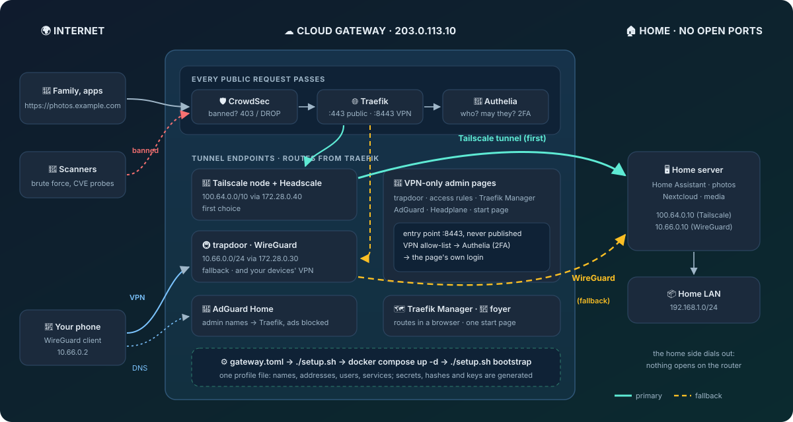
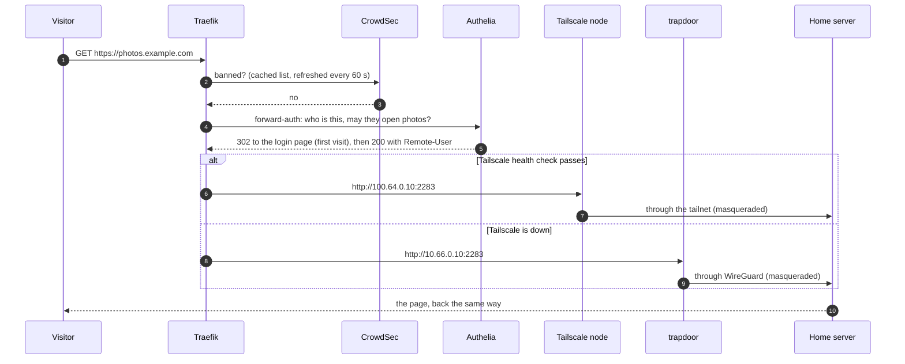
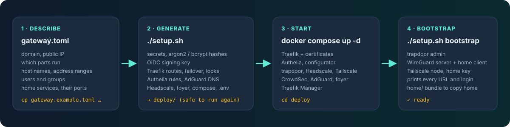
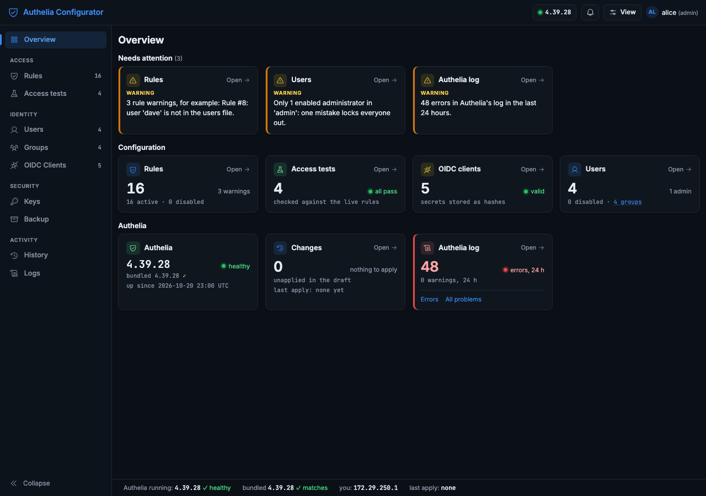
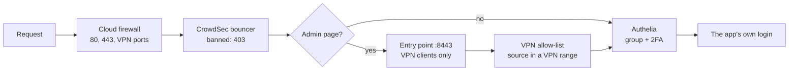

# The guide

Everything in one place: how the gateway works, how to set it up from one profile, each part,
the tunnels home, security, and keeping it running.

**Contents**

1. [What is in the box](#1-what-is-in-the-box)
2. [How it works](#2-how-it-works)
3. [Before you start](#3-before-you-start)
4. [The profile: gateway.toml](#4-the-profile-gatewaytoml)
5. [Setup and bootstrap](#5-setup-and-bootstrap)
6. [First steps after bootstrap](#6-first-steps-after-bootstrap)
7. [The parts, one by one](#7-the-parts-one-by-one)
8. [Tunnels home](#8-tunnels-home)
9. [Security](#9-security)
10. [Operations and troubleshooting](#10-operations-and-troubleshooting)
11. [What was tested](#11-what-was-tested)

---

## 1. What is in the box

| Part | Role | Reached at | Profile switch |
| :-- | :-- | :-- | :-- |
| **Traefik** | the front door: HTTPS, certificates, routing, the routes into the tunnels | ports 80, 443 | always |
| **Authelia** + Redis | login portal, 2FA, access rules for every app | `auth.example.com` (public) | always |
| **Authelia configurator** ([authelia-webui](https://github.com/shuricksumy/authelia-webui)) | rules, users, OIDC clients in a browser | `access.example.com:8443` (VPN) | always |
| **trapdoor** ([repo](https://github.com/shuricksumy/trapdoor)) | WireGuard for your devices and the home server | `trapdoor.example.com:8443` (VPN), UDP 51820 | `trapdoor` |
| **Headscale** + **Headplane** + **Tailscale** | the second tunnel, your own tailnet | `headscale.example.com` (public), `/admin` (VPN) | `headscale` |
| **CrowdSec** | bans from Traefik's and Authelia's logs | (no UI) | `crowdsec` |
| **Traefik Manager** | routes in a browser | `traefik.example.com:8443` (VPN) | `traefik_manager` |
| **AdGuard Home** | DNS for VPN clients: split DNS, ad blocking | `adguard.example.com:8443` (VPN) | `adguard` |
| **foyer** ([repo](https://github.com/shuricksumy/foyer)) | start page | `start.example.com:8443` (VPN) | `foyer` |
| **ZeroTier** + ZTNET | optional third path | `ztnet.example.com:8443` (VPN), UDP 9993 | `zerotier` |

```
homelab-gateway-stack/
  stack/                          what you run
    gateway.example.toml          the profile: copy to gateway.toml
    setup.sh, setup.py            generate · check · bootstrap
    templates/                    compose files and scripts the generator uses
  deploy/                         generated (gitignored): what docker compose runs
  docs/                           this guide, diagrams, screenshots
```

## 2. How it works

<p align="center"></p>

### The networks and the fixed addresses

Everything Traefik talks to is on one Docker network, `edge` (`172.28.0.0/24` by default). The
containers that a route, an allow-list or a trusted-proxy setting points at have **fixed
addresses** in the lower half of it; Docker hands out the upper half to everything else, so the
fixed ones are always free.

| Address | Container | Who relies on it |
| :-- | :-- | :-- |
| `.2` | Traefik | the web UIs trust `X-Forwarded-For` only from it |
| `.20` | Traefik Manager | the allow-list of Traefik's API |
| `.30` | trapdoor's VPN container | Traefik's and AdGuard's routes to the WireGuard range and the home LAN |
| `.40` | Tailscale node | the routes to `100.64.0.0/10` |
| `.41` | ZeroTier member | the routes to the ZeroTier range |
| `.53` | AdGuard Home | the DNS server VPN clients get |

| Range | What |
| :-- | :-- |
| `10.66.0.0/24` | trapdoor WireGuard: your devices (`.2`, `.3`, …) and the home server (`.10`) |
| `100.64.0.0/10` | the tailnet: the gateway (`100.64.0.1`) and the home server |
| `192.168.1.0/24` | the home LAN, behind the home server's WireGuard client |

### Routes inside Traefik

Traefik's container runs `routes.sh` every 30 seconds next to Traefik itself (its entrypoint
starts the loop, then Traefik). Traefik has `NET_ADMIN` for exactly this. AdGuard does the same,
because VPN clients ask it directly:

```
10.66.0.0/24    via 172.28.0.30   trapdoor (WireGuard)
192.168.1.0/24  via 172.28.0.30   the home LAN, behind the home client
100.64.0.0/10   via 172.28.0.40   the Tailscale node
```

> An earlier setup ran this script from a scheduler (deck-chores) through container labels.
> Tested with Docker Engine 28, the current deck-chores releases crash on bursts of Docker events,
> and the scheduler needs the Docker socket. A loop inside the container needs neither.

### NAT on the tunnel's end, none on the VPN side

- **Traefik → home:** the tunnel container masquerades Traefik's requests into the tunnel
  (`wg0.up.sh` in trapdoor, `tunnel-nat.sh` in the Tailscale and ZeroTier containers). The home
  server sees `10.66.0.1` or `100.64.0.1` and answers through the tunnel.
- **Your devices → admin pages:** no NAT. A phone at `10.66.0.2` reaches Traefik at
  `172.28.0.2` with its own address, so the VPN allow-list, Authelia's `vpn` network and the
  configurator all see who it really is. trapdoor masquerades VPN clients only toward the
  internet (`gw_priority` makes the default network the way out).

### Entry points

| Entry point | Port | Reachable from | Serves |
| :-- | :-- | :-- | :-- |
| `web` | 80, published | internet | redirect to HTTPS |
| `websecure` | 443, published | internet (and VPN) | the login portal, Headscale, your public services |
| `internal` | 8443, **not published** | VPN clients only (through the tunnels) | every admin page |
| `tmapi` | 8081, not published | Traefik Manager's address only | Traefik's API |

### One request, step by step



## 3. Before you start

**The server.** A cloud VM with a public IPv4 address and 2 GB RAM (1 GB without ZeroTier and
Traefik Manager), Debian or Ubuntu, Docker Engine with Compose **2.33 or newer**
(`docker compose version`).

**The cloud firewall:** allow in TCP 22 (SSH, ideally from your address only), TCP 80, TCP 443,
UDP 51820. Later UDP 9993 for ZeroTier. Nothing for the admin pages.

**DNS records**, `A` to the server's address, **only for the public names**:

| Name | Record | Why |
| :-- | :-- | :-- |
| `auth.example.com` | `A 203.0.113.10` | the login portal |
| `headscale.example.com` | `A 203.0.113.10` | Tailscale clients talk to it |
| one per public service (`homeassistant`, `photos`, …) | `A 203.0.113.10` | your services |
| `access`, `trapdoor`, `traefik`, `adguard`, `start`, `ztnet` | **none** | VPN-only: AdGuard answers them for VPN clients |

**A DNS API token** for certificates (recommended): the VPN-only names are not reachable from
the internet, so Let's Encrypt checks them through DNS. Cloudflare: a token with *Zone · DNS ·
Edit* for the zone. Other providers: their name and variables in Traefik's ACME provider list.
Without a token, `challenge = "http"` gets certificates for the public names only.

## 4. The profile: gateway.toml

`stack/gateway.example.toml` is a complete, commented example. Copy it to `gateway.toml`
(gitignored) and change what you need. Every key:

| Section · key | Default | Meaning |
| :-- | :-- | :-- |
| `[gateway]` `domain` | – | every name is `<host>.<domain>` |
| `public_ip` | – | the server's public IPv4 (WireGuard endpoint) |
| `email` | – | Let's Encrypt account, Authelia's sender |
| `timezone` | `UTC` | |
| `http_port`, `https_port` | `80`, `443` | only for a test on a machine where they are taken |
| `[certificates]` `challenge` | `dns` | `dns`, `http`, or `none` (self-signed, for a local test) |
| `dns_provider`, `dns_env` | `cloudflare`, `{}` | Traefik's provider name and its variables (the token) |
| `staging` | `false` | Let's Encrypt's test CA while you experiment |
| `[parts]` | all on, `zerotier` off | `trapdoor`, `headscale`, `crowdsec`, `traefik_manager`, `adguard`, `foyer`, `zerotier` |
| `[hosts]` | see table in §1 | `login`, `headscale`, `access`, `trapdoor`, `traefik`, `adguard`, `start`, `ztnet`: a name under the domain, or a full name |
| `[network]` `edge` | `172.28.0.0/24` | the Docker network (at least a `/26`); change it if it is taken |
| `wireguard`, `wireguard_port` | `10.66.0.0/24`, `51820` | trapdoor's WireGuard range and port |
| `tailscale` | `100.64.0.0/10` | Headscale's range |
| `zerotier` | `10.147.17.0/24` | |
| `home_lan` | `""` | the home LAN, reached through the home server's WireGuard client |
| `[home]` `wireguard` | `.10` of the WireGuard range | the home server's trapdoor address (bootstrap creates it) |
| `tailscale` | `100.64.0.10` | the home server's tailnet address (`headscale nodes list`) |
| `[[users]]` `name`, `display_name`, `email`, `groups`, `password` | | one entry per person; empty password = generated. At least one in `admins` (it also becomes trapdoor's and AdGuard's admin) |
| `[[services]]` `name`, `port` | – | one entry per home service: `https://<host>.<domain>` |
| `host` | `name` | |
| `title`, `icon` | | for the start page (an icon name of foyer's `icons/`) |
| `health` | `/` | a path that answers 200 **without a login** |
| `login` | `true` | Authelia in front; `false` for apps whose own clients cannot pass a login page |
| `groups` | `["admins"]` | who may open it (with `login`) |
| `public` | `true` | `false`: VPN-only, on the internal entry point |
| `tailscale`, `wireguard` | `[home]` | the addresses through each tunnel; two = failover |
| `prefer` | `tailscale` | which tunnel first |
| `address` | | instead of the tunnels: a device on `home_lan` |
| `scheme` | `http` | |
| `[smtp]` `address`, `username`, `password`, `sender` | | Authelia's emails; without it they go to `authelia/notification.txt` |
| `[versions]` | pinned | override one image version, e.g. `trapdoor = "0.4"` |

## 5. Setup and bootstrap

```bash
cd stack
sudo ./setup.sh                 # generate ../deploy (sudo: sets the owners the containers need)
sudo ./setup.sh check           # docker compose config + Authelia's own validate-config
cd ../deploy && docker compose up -d
sudo ../stack/setup.sh bootstrap
```

`setup.sh` uses the host's Python 3.11+, or runs itself in a small container when the host's
Python is older. It needs Docker: password hashes and keys are made with the pinned Authelia and
httpd images.

**What `setup.sh` (generate) writes into `deploy/`:**

| File | Written | Notes |
| :-- | :-- | :-- |
| `secrets.env` | once, then kept | every generated secret and password (mode 600) |
| `.env`, `compose.*.yml`, `dns-provider.env` | every run | `COMPOSE_FILE` lists the enabled parts |
| `traefik/traefik.yml`, `traefik/dynamic/{core,admin,headscale,security,traefik-manager}.yml` | every run | |
| `traefik/dynamic/profile-services.yml` | every run | your `[[services]]` with failover |
| `traefik/dynamic/services.yml` | **once** | yours and Traefik Manager's: never overwritten |
| `authelia/configuration.yml` | every run | |
| `authelia/managed/*` (rules, users, OIDC, signing key) | **once** | the configurator's from then on; `--reset-managed` rewrites them |
| `data/adguard/conf/AdGuardHome.yaml` | **once** | AdGuard's own afterwards |
| `headscale/`, `headplane/`, `foyer/config.yaml`, `home/` | every run | |

So: edit the profile, run `setup.sh` again, `docker compose up -d`. Changes made in the web UIs
survive.

**What `bootstrap` does** (safe to run again; it skips what exists):

1. trapdoor: creates the admin (the first `admins` user, same password), the WireGuard server
   `wg0` (DNS = AdGuard; clients' allowed IPs = the VPN, the edge network, the home LAN), turns
   on its scripts (NAT into the tunnel, clients' DNS redirected to AdGuard), creates the client
   `home` (config: `deploy/home/wg-gateway.conf`) and one for your first device
   (`deploy/clients/<you>-device.conf`).
2. Headscale: creates the user `gateway`, logs this server's Tailscale node in, writes a 24-hour
   key for the home server to `deploy/home/.env`, and a Headplane API key to
   `deploy/secrets/headplane-api-key.txt`.
3. Prints every address and every login.

<p align="center"></p>

## 6. First steps after bootstrap

1. **Your first device on the VPN.** Bootstrap made a client for it:
   `deploy/clients/<you>-device.conf`. Import that file in the WireGuard app (phone: *Add tunnel →
   Import from file*; or `qrencode -t ansiutf8 < you-device.conf` on the server and scan it).
   Every admin page opens by name from then on; more devices: trapdoor → Clients → *Add client*.
2. **Your 2FA.** On the phone (VPN on), open `https://access.example.com:8443`. Sign in; Authelia
   asks you to register a one-time code app. Without `[smtp]`, the registration link is in
   `deploy/authelia/notification.txt`.
3. **The home server.** Copy `deploy/home/` there and follow its `README.md`: WireGuard with
   `wg-gateway.conf`, Tailscale with `compose.tailscale.yml`, and the trusted proxies for your
   apps. Then check `[home] tailscale` against `docker compose exec headscale headscale nodes list`.
4. **Traefik Manager.** Its one-time password is in `docker compose logs traefik-manager`. In its
   setup wizard the Traefik API URL is `http://172.28.0.2:8081` and **skip "Self route"**
   ([authelia-webui's notes](https://github.com/shuricksumy/authelia-webui/blob/main/docs/traefik-manager.md)).
5. **Headplane:** `https://headscale.example.com:8443/admin`, with the key from
   `deploy/secrets/headplane-api-key.txt`.

**Check that it works:**

```bash
docker compose ps                                              # all up, health checks healthy
docker compose exec traefik ip route                           # one route per tunnel range
docker compose exec trapdoor-vpn wg show wg0                   # home and your phone: recent handshakes
docker compose exec traefik wget -qO- -T 5 http://10.66.0.10:8123/manifest.json   # home through WireGuard
docker compose exec traefik wget -qO- -T 5 http://100.64.0.10:8123/manifest.json  # home through Tailscale
```

- Off the VPN: the admin names do not resolve, and `https://203.0.113.10:8443` times out.
- On the VPN: every admin page asks for the Authelia login (2FA), then its own.
- Stop Tailscale at home: within 15 s the services still answer, over WireGuard.

## 7. The parts, one by one

### 🌐 Traefik

Static config `deploy/traefik/traefik.yml` (read at start: `docker compose up -d
--force-recreate traefik` after a change); routes in `deploy/traefik/dynamic/` (reloaded by
themselves). **Do not edit generated files by hand** except `services.yml`: change the profile.

### 🔐 Authelia and the configurator

The login portal at `auth.example.com`. Everything that changes often (rules, users, OIDC clients
for apps that support it) is edited in the configurator at `access.example.com:8443`: every change
is validated by Authelia itself, committed, and rolled back automatically if Authelia does not come
back healthy. Groups from the profile (`admins`, `family`, …) are what the rules use.
Deep dive: [authelia-webui](https://github.com/shuricksumy/authelia-webui) and its
[docs](https://github.com/shuricksumy/authelia-webui/tree/main/docs) (sessions, emergency login,
OIDC presets, hardening).



### 🚇 trapdoor

The VPN: one client per device, QR codes, live sessions, traffic history, access rules (which
client may reach which network), scheduled backups. The home server is just another client, with
the home LAN behind it. Deep dive: [trapdoor's guide](https://github.com/shuricksumy/trapdoor/blob/main/docs/guide.md).
Coming from openvpn-ui or WGDashboard: trapdoor's guide has a migration section.

### 🔁 Headscale, Headplane, Tailscale

Your own tailnet. The gateway's node (`100.64.0.1`) is the second tunnel's endpoint; the home
server joins with the key from bootstrap. Tailscale connects the two machines directly when it can,
so this path does not load the gateway's VPN at all. Headplane manages nodes, users and ACLs.

### 🛡️ CrowdSec

Reads Traefik's access log and Authelia's log, bans by scenario (scanners, brute force, CVE
probes), and pulls the community blocklist. Traefik's bouncer plugin enforces bans on every public
router; your VPN ranges and the home LAN are never banned. Useful commands:

```bash
docker compose exec crowdsec cscli decisions list            # who is banned
docker compose exec crowdsec cscli alerts list --since 168h  # what happened this week
docker compose exec crowdsec cscli decisions delete -i <ip>  # unban
```

More layers (a firewall bouncer for every port, Cloudflare in front, static blocklists):
authelia-webui's [hardening.md](https://github.com/shuricksumy/authelia-webui/blob/main/docs/hardening.md),
[firewall-bouncer.md](https://github.com/shuricksumy/authelia-webui/blob/main/docs/firewall-bouncer.md),
[blocking.md](https://github.com/shuricksumy/authelia-webui/blob/main/docs/blocking.md).

### 🗺️ Traefik Manager

Routes, services and middlewares in a browser, with a route map and a backup before every change.
It edits `services.yml` only: the generated files (and the protection of the admin pages) are out
of its reach. Pick the `authelia` middleware for anything that should need a login.

### 🧭 AdGuard Home

DNS for VPN clients, with a login (the first admin's) and the rewrites of every gateway name to
Traefik's internal address, all generated. trapdoor additionally redirects VPN clients' plain DNS
to it and blocks DNS-over-TLS, so apps cannot go around it.

### 🏁 foyer

The start page at `start.example.com:8443`: your services and every admin page, generated from
the profile. trapdoor and the configurator open inside it (they allow being framed by this page
only). Options: [foyer's README](https://github.com/shuricksumy/foyer).

### 🕸️ ZeroTier (optional)

`zerotier = true` adds ZTNET (web UI), PostgreSQL and a ZeroTier controller that is also a member
of its own network. In ZTNET, create a network with the range of `[network] zerotier`, then
`docker compose exec zerotier zerotier-cli join <network-id>` and authorize the gateway there.
Use it as a third path or for a second site (`address`/`tailscale`/`wireguard` of a service can
point anywhere Traefik has a route to).

## 8. Tunnels home

Three pieces make a tunnel work; miss one and requests time out while every tunnel looks up:

| | What | Where | Symptom when missing |
| :-- | :-- | :-- | :-- |
| ① | a **route** in Traefik to the tunnel's range | `routes.sh` (`TUNNEL_ROUTES` in `.env`) | Traefik sends the request to the internet |
| ② | **NAT** on the tunnel's end | `wg0.up.sh`, `tunnel-nat.sh` | the home server answers a network it does not know: timeouts |
| ③ | the **app trusts the proxy** | the app's settings at home | *400 Bad Request* |

**Trusted proxies at home** (with NAT, requests come from the gateway's tunnel address):

| Path | Source the app sees | Trust |
| :-- | :-- | :-- |
| WireGuard | `10.66.0.1` | `10.66.0.0/24` |
| Tailscale | `100.64.0.1` | `100.64.0.0/10` |

Home Assistant, `configuration.yaml`:

```yaml
http:
  use_x_forwarded_for: true
  trusted_proxies: [10.66.0.0/24, 100.64.0.0/10]
```

**Failover.** Each service with two tunnel addresses becomes three Traefik services:

```yaml
homeassistant:
  failover: {service: homeassistant-ts, fallback: homeassistant-wg}
homeassistant-ts:
  loadBalancer:
    servers: [{url: "http://100.64.0.10:8123"}]
    healthCheck: {path: /manifest.json, interval: 15s, timeout: 3s}
homeassistant-wg:
  loadBalancer:
    servers: [{url: "http://10.66.0.10:8123"}]
    healthCheck: {path: /manifest.json, interval: 15s, timeout: 3s}
```

Traefik uses the first while its health check passes, switches within one interval when it fails,
and switches back. The health path must answer 200 without a login: `/manifest.json` (Home
Assistant), `/api/server/ping` (Immich), `/status.php` (Nextcloud), `/identity` (Plex).

**Devices on the home LAN** (a router, a NAS): set `home_lan`, then a service with
`address = "192.168.1.1"`. The home server forwards into its LAN (`deploy/home/README.md`).

**Adding a service:** add a `[[services]]` entry, `setup.sh`, `docker compose up -d`, a public DNS
record if it is public, the trusted proxies in the app. Check from the gateway with the
`docker compose exec traefik wget …` lines in §6.

## 9. Security



| Host | From the internet | From the VPN |
| :-- | :-- | :-- |
| `auth.`, `headscale.` | yes | yes |
| your public services | yes (Authelia unless `login = false`) | yes |
| `access.`, `trapdoor.`, `traefik.`, `adguard.`, `start.`, `ztnet.`, Headplane | **no**: no DNS record, port not published | yes, behind the allow-list, Authelia (admins, 2FA), their own login |

- **No Docker socket** in Traefik, Traefik Manager or the configurator. The configurator restarts
  Authelia through a socket proxy that allows exactly two calls.
- **Traefik Manager cannot weaken its own protection**: it edits `services.yml` only.
- **Every web UI trusts `X-Forwarded-For` from Traefik's address only.**
- **Fails open where it is safe** (CrowdSec down: sites stay up), **closed where it matters**
  (the configurator refuses to start without its allowed networks).
- **Secrets stay out of git:** the profile, `deploy/` and keys are gitignored; `secrets.env` and
  Authelia's files are mode 600.

## 10. Operations and troubleshooting

**Updates.** Versions are pinned in `setup.py` (`VERSIONS`) and can be overridden in
`[versions]`. Change one, `setup.sh`, `docker compose pull && docker compose up -d`, then the
checks of §6. Authelia and the configurator share one version (the configurator refuses to apply
while they differ). [renovate-config](https://github.com/shuricksumy/renovate-config) can keep the
pins up to date.

**Backups.** The profile, `deploy/secrets.env`, `deploy/authelia/`, `deploy/data/` (Headscale,
Tailscale, trapdoor, AdGuard, Traefik Manager). trapdoor also has scheduled, encrypted backups
(Account page; the passphrase is `TD_BACKUP_PASSPHRASE` in `secrets.env`), and the configurator
has History → Backup.

```bash
sudo tar -czf ~/gateway-$(date +%F).tgz -C "$(pwd)/.." stack/gateway.toml deploy \
  --exclude=deploy/data/logs --exclude=deploy/data/crowdsec/data
```

**Disk and memory.** Every container rotates its Docker log (15 MB × 3). Prune old images weekly
(`docker image prune -a -f --filter until=168h`). Add a 1–2 GB swap file on a small VM.

| Symptom | Likely cause | Fix |
| :-- | :-- | :-- |
| a home service: *503 no available server* | both tunnels' health checks fail | the checks of §6 from the gateway; the home side's `wg show`, `tailscale status` |
| a home service times out, the tunnel has a recent handshake | the NAT rule is missing | `docker compose exec trapdoor-vpn iptables -t nat -S` shows `! -s 10.66.0.0/24 -o wg0 -j MASQUERADE`; trapdoor → Server → Scripts state `ok` |
| *400 Bad Request* from the app | it does not trust the tunnel | §8, trusted proxies |
| admin page: name does not resolve | the device does not use AdGuard | the VPN client's DNS is `172.28.0.53`; check *Allowed IPs* include the edge network |
| admin page: *403* on the VPN | NAT between the VPN and the edge network | `docker compose exec trapdoor-vpn ip route`: the default route must use the default network (`gw_priority`, Compose 2.33+) |
| DNS works for Traefik's names but nothing answers | AdGuard has no route back | `docker compose exec adguard ip route` lists the tunnel ranges |
| every site *403* for one visitor | banned | `cscli decisions list -i <ip>`, `cscli decisions delete -i <ip>` |
| certificates do not arrive | DNS token, rate limit | `docker compose logs traefik \| grep -i acme`; `staging = true` while testing |
| Traefik ignores a static change | read at start only | `docker compose up -d --force-recreate traefik` |
| all routes 404 | an invalid file in `traefik/dynamic/` stops the whole file provider | `docker compose logs traefik \| grep ERR` |

## 11. What was tested

`setup.sh` was run with the example profile on a local Docker (challenge `none`, ports moved) and
the stack started with every part except ZeroTier. Checked:

- every compose file combination passes `docker compose config`; Authelia's `validate-config` passes;
- all containers start, health checks healthy; the routes appear in Traefik's and AdGuard's namespaces,
  the NAT rule in the Tailscale node; the Tailscale node logs in to Headscale;
- bootstrap creates the trapdoor admin, `wg0`, the scripts, the `home` client and its config, the
  Headscale user and keys; a second run changes nothing;
- the generated password signs in to Authelia (`200`), a wrong one does not (`401`);
- public: the portal `200`, a service behind Authelia `302` to the login;
- a WireGuard client connected through the published port: AdGuard answers it, the admin names
  resolve to Traefik, the admin pages answer `302` to the login (the allow-list sees `10.66.0.2`),
  while a non-VPN source gets `403`;
- a simulated home server using the generated `home/wg-gateway.conf`: Home Assistant's path
  answers `200` through Traefik, served by the WireGuard fallback while Tailscale was not running.

Not tested here: real certificates (needs your domain), ZeroTier end to end, and a real home
network. Do the checks of §6 on yours.
