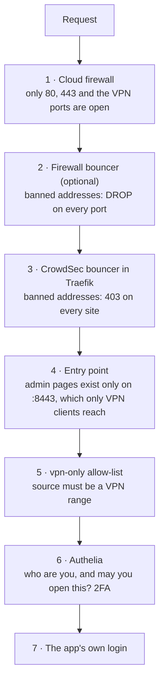

# Security

What is public, what is VPN-only, and the locks in front of each. The rule of thumb: **every
admin page has three independent locks**, so one mistake (a wrong route, a forgotten rule)
never exposes anything on its own.

## The layers

Public services pass layers 1, 2, 3, 6 and 7 (or 1, 2, 3 and 7 for apps whose clients cannot
pass a login page). Admin pages pass all seven.

## What is reachable from where

| Host | From the internet | From the VPN | Locks |
| :-- | :-- | :-- | :-- |
| `auth.example.com` (login portal) | yes | yes | CrowdSec, Authelia's own regulation (bans after failed logins) |
| `hs.example.com` (Headscale) | yes | yes | CrowdSec; nodes need a pre-auth key or your approval |
| `home.example.com` (Home Assistant) | yes | yes | CrowdSec, the app's login with 2FA, its `ip_ban` |
| `photos.example.com` | yes | yes | CrowdSec, Authelia (group, 2FA), the app's login |
| `vpn.`, `authcfg.`, `tm.`, `dns.`, `start.`, `zt.` | **no**: no DNS record, no open port | yes | entry point, allow-list, Authelia (admin group, 2FA), the app's login |
| `hs.example.com/admin` (Headplane) | **no** (internal entry point only) | yes | same as above, plus a Headscale API key |
| SSH | your address only (cloud firewall) | yes | keys only, no passwords |

## Choices that matter

- **No Docker socket in Traefik, Traefik Manager or the configurator.** Routes come from files.
  The configurator restarts Authelia through a socket proxy that allows exactly two API calls
  (inspect and restart one container). A compromised web UI cannot start containers.
- **Traefik Manager cannot weaken its own protection.** It edits `routes.yml` only; the files
  with the admin routes, the allow-list and the CrowdSec middlewares are outside its reach.
- **Each web UI trusts `X-Forwarded-For` from Traefik's address only** (`TRUSTED_PROXY_CIDRS`,
  `TD_TRUSTED_PROXIES`, `TRUSTED_PROXIES`). Nobody else can claim to be a VPN client.
- **VPN clients reach Traefik without NAT**, so every layer sees their real address. If you put
  NAT there, every VPN client looks like the vpn container, and the allow-lists must trust that
  one address (then any VPN client passes, which is what you want only if every VPN client is
  trusted).
- **Fails open where it is safe, closed where it matters.** CrowdSec down: sites stay up
  (`updateMaxFailure: -1`). The configurator without `ALLOWED_CLIENT_CIDRS`: it refuses to start.
- **Secrets stay out of the repo.** `.env`, the bouncer key and everything in `data/` are
  gitignored. Authelia's secrets are files with mode 600.
- **Frames only from your start page.** trapdoor and the configurator allow being framed by
  `https://start.example.com` only (`frame-ancestors`); everything else keeps refusing frames.

## Hardening further

authelia-webui's guides go further, all optional:

- [hardening.md](https://github.com/shuricksumy/authelia-webui/blob/main/docs/hardening.md): the
  real client address behind a CDN, Cloudflare in front with the origin locked to it, login
  throttling per address.
- [firewall-bouncer.md](https://github.com/shuricksumy/authelia-webui/blob/main/docs/firewall-bouncer.md):
  CrowdSec's bans on every port, including SSH and the VPN.
- [blocking.md](https://github.com/shuricksumy/authelia-webui/blob/main/docs/blocking.md),
  [static-blocklist.md](https://github.com/shuricksumy/authelia-webui/blob/main/docs/static-blocklist.md):
  more ways to block, and where each one acts.
- [emergency.md](https://github.com/shuricksumy/authelia-webui/blob/main/docs/emergency.md): a
  break-glass login for when Authelia itself is down.

For the VPN: trapdoor's [access rules](https://github.com/shuricksumy/trapdoor/blob/main/docs/guide.md#access-rules)
decide which VPN client may reach which network. Put family devices in a group that reaches the
home services but not the admin pages.
