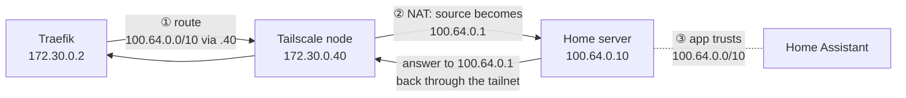

# Tunnels home

How Traefik on the cloud server reaches a service on your home server, and how a second tunnel
takes over when the first one fails. Three pieces make it work; miss one and requests time out
while every tunnel looks healthy.



1. **A route** in Traefik's namespace sends the tunnel's range to the container that owns the
   tunnel. Without it, Traefik sends `100.64.0.10` to its default gateway, the internet.
2. **NAT on the tunnel's end** gives the request the tunnel's own source address. Without it the
   home server receives a request from `172.30.0.2`, a network it has never heard of, and its
   answer goes to its own default gateway, the home router. Lost.
3. **The app trusts the proxy.** Requests carry `X-Forwarded-For` with the visitor's address;
   apps that check where it comes from answer **400 Bad Request** for an untrusted source.

## ① Routes

[`traefik/routes.sh`](../examples/traefik/routes.sh) runs in the `traefik-routes` helper, which
shares Traefik's network namespace and has `NET_ADMIN` there. Traefik itself gets no extra
capability. The pairs come from `.env`:

```yaml
# compose.yml, traefik-routes
ROUTES: >-
  ${WG_SUBNET}=${IP_VPN_WG}        # 10.8.10.0/24   via 172.30.0.30
  ${OVPN_SUBNET}=${IP_VPN_WG}      # 10.8.1.0/24    via 172.30.0.30
  ${HOME_LAN}=${IP_VPN_WG}         # 192.168.1.0/24 via 172.30.0.30
  ${TS_SUBNET}=${IP_TAILSCALE}     # 100.64.0.0/10  via 172.30.0.40
  ${ZT_SUBNET}=${IP_ZEROTIER}      # 10.147.17.0/24 via 172.30.0.41
```

It uses `ip route replace` every 30 s, so a recreated Traefik gets its routes back, and a
changed gateway is corrected. The gateways must keep their addresses: they are fixed in the
compose files from `.env`. **A tunnel container recreated without its fixed address breaks
every route through it.** Docker then gives it the next free address, and the route points at
nothing. Keep each address in `.env` (not in a shell variable that is set only by a deploy
script), and check after any `docker compose up`:

```sh
docker inspect -f '{{.Name}} {{range $k,$v := .NetworkSettings.Networks}}{{$k}}={{$v.IPAddress}} {{end}}' \
  $(docker compose ps -q) | grep edge
```

## ② NAT into the tunnel

| Tunnel | Where the rule lives | Rule |
| :-- | :-- | :-- |
| WireGuard (trapdoor) | `data/trapdoor/wireguard/wg0.up.sh` / `wg0.down.sh`, run by trapdoor's vpn container while `wg0` is up ([`trapdoor/`](../examples/trapdoor/)) | `-o wg0 ! -s 10.8.10.0/24 -j MASQUERADE` |
| Tailscale | the `tailscale-nat` helper ([`scripts/tunnel-nat.sh`](../examples/scripts/tunnel-nat.sh)) | `-s 172.30.0.0/24 -o tailscale0 -j MASQUERADE` |
| ZeroTier | the `zerotier-nat` helper | `-s 172.30.0.0/24 -o zt+ -j MASQUERADE` |

The WireGuard rule skips the VPN's own range (`! -s 10.8.10.0/24`): between your devices and
the home server, addresses stay as they are, so trapdoor's access rules and traffic history
still see who is who.

**The alternative without NAT:** add `172.30.0.0/24` to the home client's allowed IPs (WireGuard)
or advertise it as a route (Tailscale). The home server then sees Traefik's address `172.30.0.2`
and answers into the tunnel. It works, but every home client needs it, and an app that trusts
"the proxy" now has to trust a Docker address. NAT keeps the home side simple.

**How to tell that NAT is missing:** the tunnel is up (handshake seconds ago), the home
server can ping the gateway, yet `docker compose exec traefik wget -T 5 http://10.8.10.10:8123`
times out. On the home server, `tcpdump -ni wg-gateway port 8123` shows requests from
`172.30.0.2` and no answers.

## ③ Trusted proxies at home

The source the home app sees, with NAT:

| Path | Source address | Trust |
| :-- | :-- | :-- |
| WireGuard | `10.8.10.1` (trapdoor's address in `wg0`) | `10.8.10.0/24` |
| Tailscale | `100.64.0.1` (the gateway's node) | `100.64.0.0/10` |
| ZeroTier | the gateway's member address | `10.147.17.0/24` |

[`home/README.md`](../examples/home/README.md) has the Home Assistant and Nextcloud settings.
Trust these ranges only, never `0.0.0.0/0`: whoever is trusted may claim any visitor address.

## Failover

Each service in [`routes.yml`](../examples/traefik/dynamic/routes.yml) is three services:

```yaml
home:                      # the router points here
  failover: {service: home-ts, fallback: home-wg}
home-ts:                   # first choice: Tailscale
  loadBalancer:
    servers: [{url: "http://100.64.0.10:8123"}]
    healthCheck: {path: /manifest.json, interval: 15s, timeout: 3s}
home-wg:                   # fallback: WireGuard
  loadBalancer:
    servers: [{url: "http://10.8.10.10:8123"}]
    healthCheck: {path: /manifest.json, interval: 15s, timeout: 3s}
```

- Traefik sends everything to `home-ts` while its health check passes. When it fails, everything
  goes to `home-wg` within one interval. When `home-ts` recovers, traffic goes back.
- **A health check on the main service is required.** Without one, Traefik never notices it is
  down. Pick a path that answers 200 without a login: `/manifest.json` (Home Assistant),
  `/api/server/ping` (Immich), `/status.php` (Nextcloud), `/identity` (Plex).
- **Failover, not load balancing.** One `loadBalancer` with both addresses splits requests
  between the tunnels instead (round robin). Both work; failover keeps the traffic on the tunnel
  you chose, which matters when one of them is metered or slower.
- **Which tunnel first?** Tailscale usually connects directly between the two machines, so it
  adds no load to the gateway's VPN server; WireGuard through trapdoor is fully under your
  control and shows up in trapdoor's traffic history. Either order is fine. Swap `service` and
  `fallback` to change it.
- Apps that need **websockets** (Home Assistant) work through both; Traefik proxies them by default.

## Reaching the home LAN

The home server can also carry traffic for other devices at home (a router UI, a NAS, a camera):

1. In trapdoor, add `192.168.1.0/24` under the home client's **networks behind it**. trapdoor
   then sends that range to the home client.
2. On the home server, forward and masquerade into the LAN
   ([`home/README.md`](../examples/home/README.md), part 1).
3. Traefik already has the route (`HOME_LAN` in `.env`). Point a service at the device:
   `http://192.168.1.1` ([`admin.yml`](../examples/traefik/dynamic/admin.yml) has a router UI example).

Your own VPN devices reach the LAN too, if their allowed IPs include `192.168.1.0/24`.

## Adding a service: the checklist

1. The service answers on the home server: `curl http://localhost:<port>` there.
2. The gateway reaches it through each tunnel:
   `docker compose exec traefik wget -qO- -T 5 http://100.64.0.10:<port><health-path>` and the same with `10.8.10.10`.
3. Three services and a router in `routes.yml` (by hand or in Traefik Manager), the `authelia`
   middleware unless the app's own clients cannot pass a login page.
4. A public DNS record for the name, an Authelia rule for it (configurator).
5. The app trusts the tunnel ranges (400 otherwise).
6. Open it from mobile data. Then stop one tunnel at home and open it again.

## OpenVPN instead of WireGuard

trapdoor runs OpenVPN servers too (`10.8.1.0/24`, UDP 1194 here). The home server becomes an
OpenVPN client instead; the route, the NAT (the own scripts of an OpenVPN server are
`data/trapdoor/openvpn/trapdoor-up.sh` / `trapdoor-down.sh`) and the trusted proxies work the
same way with that range. WireGuard is lighter and reconnects faster, so it is the better
fallback tunnel; OpenVPN over TCP helps on networks that block UDP. AmneziaWG (also in trapdoor)
gets through networks that block WireGuard itself.
